[portfolio](https://rifqi.apexsions.com) &nbsp;·&nbsp;
[blog](https://rifqi.apexsions.com) &nbsp;·&nbsp;
[resume](https://rifqi.apexsions.com) &nbsp;·&nbsp;
[xssscope](https://github.com/Nueeva/xssscope) &nbsp;·&nbsp;
[ctf-toolkit](https://github.com/Nueeva/CTF-Toolkit) &nbsp;·&nbsp;
[clouvia](https://linktr.ee/die_de_nueva) &nbsp;·&nbsp;
[linkedin](https://linkedin.com/in/Nueva) &nbsp;·&nbsp;
[email](mailto:rifqiariansyah123@gmail.com)

 

> **Rifqi Ariansyah** &nbsp;·&nbsp; `Nueeva` &nbsp;·&nbsp; Cybersecurity Researcher & Systems Developer 
> *Identifying vulnerabilities before they become threats.* Focus: Application Security, Reflected Sinks, and Hardened Architectures.

Self-taught security researcher and software engineer with a deep passion for Web Application Pentesting, Cryptography, and Offensive Tooling.

- 🛡️ **Specialization:** Web Application Pentesting, Reflected XSS Analysis, and Defensive Code Review.
- 🔬 **Active Research:** Developing zero-dependency offensive tooling (**[xssscope](https://github.com/Nueeva/xssscope)**) and modular CTF frameworks (**[CTF-Toolkit](https://github.com/Nueeva/CTF-Toolkit)**).
- 💼 **Ecosystem:** Founder & Lead at **[Clouvia](https://linktr.ee/die_de_nueva)** (Cloud hosting & secure web infrastructure).
- 🤝 **Engagement Status:** Open for **Web Security Audits, Pentesting Collaborations, and Vulnerability Research**.
- 📬 **Direct Inquiries:** [rifqiariansyah123@gmail.com](mailto:rifqiariansyah123@gmail.com) &nbsp;·&nbsp; **Portfolio:** [rifqi.apexsions.com](https://rifqi.apexsions.com) &nbsp;·&nbsp; **Articles:** [rifqi.apexsions.com](https://rifqi.apexsions.com)

 

- 🔍 **[xssscope](https://github.com/Nueeva/xssscope)** — Reflected XSS scanner with context detection. Zero dependencies; probe, classify, verify.
- 🛡️ **[CTF-Toolkit](https://github.com/Nueeva/CTF-Toolkit)** — Modular terminal framework for CTF & security labs: Crypto, BinEx, Web, DFIR.
 

**Other Platforms:**
* **[Clouvia](https://linktr.ee/die_de_nueva)** &nbsp;·&nbsp; Cloud hosting, secure infrastructure, and web platforms.
* **[rifqi.apexsions.com](https://rifqi.apexsions.com)** &nbsp;·&nbsp; Personal portfolio showcasing security projects, technical writeups, and full-stack systems.

 

  <strong>Offensive Security &amp; Analysis</strong> 
  
  
  
  
  

  <strong>Core Languages &amp; Runtimes</strong> 
  
  
  
  
  
  

  <strong>Infrastructure, Storage &amp; Cloud</strong> 
  
  
  
  
  
  

 

 

 

  
  
  
  
  
  

 

Every graphic here is self-generated, not embedded from third-party hosting services. 
`ascii.svg` renders typewriter-animated monochrome ASCII branding with SMIL; 
the stat graphics and section headings are drawn by a [scheduled GitHub Action](.github/workflows/stats.yml) 
straight from the GitHub GraphQL API, once a day, committing only what changed.

They animate via SMIL inside the SVG because GitHub strips scripts and inline CSS from READMEs. 
Because nothing loads from external analytics hosts, nothing can rate-limit, break, or go dark. 
The typeface is [JetBrains Mono](scripts/fonts), subsetted to character usage and inlined as base64.
